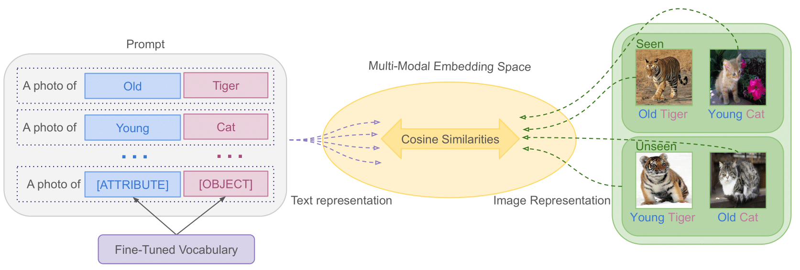

# Continual Compositional Soft Prompting (CSP)

This repository adapts **Compositional Soft Prompting (CSP)** to **continual compositional zero-shot learning (CCZSL)**. In CCZSL, new attributes, objects, and attribute–object compositions arrive over a sequence of sessions. The model has to learn the new ones without forgetting the old ones.

It is the CSP baseline used in **[Prompt-Based Continual Compositional Zero-Shot Learning](https://arxiv.org/abs/2512.09172)** and follows that paper's session splits. CLIP stays frozen, and the only trainable parameters are the soft attribute and object token embeddings. In each new session, the vocabulary from the previous session is carried over, and knowledge distillation from the previous session's model limits forgetting.

- Original CSP paper: [Learning to Compose Soft Prompts for Compositional Zero-Shot Learning](https://arxiv.org/abs/2204.03574) (ICLR 2023)
- Original CSP code: [BatsResearch/csp](https://github.com/BatsResearch/csp)



## Method

**Session 0 (base).** Standard CSP: the prompt `a photo of [attr] [obj]` is built from learnable soft tokens for each attribute and object. These tokens are trained with cross-entropy over the session-0 training pairs (`train.py`).

**Session *t* > 0 (continual).** `session_train.py` does the following:

1. **Teacher.** Builds the session *t−1* model and loads its soft embeddings. The teacher is frozen.
2. **Student initialisation.** Builds a model over the larger vocabulary of session *t*. It copies the teacher's attribute and object embeddings into the matching rows. New primitives start from CLIP's token embeddings for their names.
3. **Training.** For each batch:

   ```
   L = (1 − α) · CE(student logits over all session-t train pairs, labels)
       + α · KL(student ‖ teacher) on the logits of the previous-session pairs, temperature T = 2.5
   ```

The default is `α = 0.65`. Only the soft embeddings are optimised; the CLIP image and text encoders stay frozen throughout.

> **Index ordering.** Attribute, object, and pair indices come from global index maps built for the **final** session (`selected_session_g_pair2_idx` in each `datasets/*_read_datasets.py`). The code assumes that, in those maps, each session's new primitives and pairs come **after** all earlier ones. The teacher-to-student embedding copy and the `[:pair_end]` slice in the distillation loss both rely on this.

## Session splits

| Dataset    | Sessions  | Attributes (cumulative) | Objects (cumulative)  | Train pairs (cumulative)    |
|------------|-----------|-------------------------|-----------------------|-----------------------------|
| UT-Zappos  | s0 – s2   | 8 → 12 → 16             | 6 → 9 → 12            | 24 → 51 → 83                |
| MIT-States | s0 – s3   | 37 → 62 → 88 → 115      | 71 → 132 → 190 → 245  | 161 → 439 → 800 → 1262      |
| C-GQA      | s0 – s4   | 233 → 268 → 300 → 336 → 375 | 363 → 421 → 488 → 552 → 614 | 2392 → 2883 → 3655 → 4491 → 5053 |

These numbers are defined in `ALL_ATTR_OBJ_PAIRS` and `TRAIN_PAIRS` in the dataset reader files.

## Project structure

```text
.
├── train.py                     # session 0 training (plain CSP)
├── session_train.py             # sessions 1..N: teacher–student training with KD
├── evaluate.py                  # closed-world evaluation for a given session
├── datasets/
│   ├── composition_dataset.py   # student / evaluation dataset (current session)
│   ├── teacher_dataset.py       # dataset used to build the teacher (previous session)
│   ├── cgqa_read_datasets.py    # paths + session config for C-GQA
│   ├── mit_read_datasets.py     # paths + session config for MIT-States
│   └── utzappos_read_datasets.py
├── models/                      # CSP / CoOp model definitions
├── clip_modules/                # CLIP text-encoder interface
├── run_train_{utzappos,mit,cgqa}.sh
├── run_test_{utzappos,mit,cgqa}.sh
└── requirements.txt
```

## Installation

```bash
conda create --name clip python=3.7
conda activate clip
pip install -r requirements.txt
```

To install the dependencies by hand instead:

```bash
pip3 install torch torchvision torchaudio --extra-index-url https://download.pytorch.org/whl/cu113
pip3 install ftfy regex tqdm scipy pandas
pip3 install git+https://github.com/openai/CLIP.git
```

## Dataset setup

1. Download the CCZSL session splits from the [PromptCCZSL paper](https://arxiv.org/abs/2512.09172), along with the MIT-States, UT-Zappos, and C-GQA images.
2. Open the reader file for each dataset and set `DATASET_PATHS` to where you put the data. The paths in the repository are absolute paths from the authors' machine, so **you have to change them**:
   - `datasets/utzappos_read_datasets.py`
   - `datasets/mit_read_datasets.py`
   - `datasets/cgqa_read_datasets.py`

The reader files expect a dataset root with one folder per session. C-GQA example:

```text
<DATASET_ROOT>/
├── images/
├── session 0/
│   ├── metadata_compositional-split-natural.t7
│   ├── compositional-split-natural/{train,val,test}_pairs.txt
│   └── idx/updated_{attr,obj,pair}2idx_session0.json
├── session 1/
│   ├── 1metadata_compositional-split-natural.t7     # session-1 data only
│   ├── 01 pairs/compositional-split-natural/...     # accumulated pairs s0+s1
│   └── idx/...
└── ...
```

- **`t7_files`** select the image metadata used for a session. A file can contain only the current session's data (`1metadata…`) or accumulated data (`01metadata…`), so set it to match the experiment you want. The commented-out entries in each reader file show the accumulated variants.
- **`teacher_t7_files`** map each session to the metadata of the session before it, which is used to build the teacher.

## Training

Each `run_train_*.sh` script contains one block per session. **Uncomment the session you want to run**, and run the sessions in order, because each one loads the soft embeddings saved by the previous one.

```bash
bash run_train_utzappos.sh
bash run_train_mit.sh
bash run_train_cgqa.sh
```

### Session 0

```bash
python -u train.py \
  --dataset cgqa \
  --experiment_name csp \
  --clip_model ViT-L/14 \
  --seed 0 \
  --epochs 20 \
  --lr 5e-05 \
  --attr_dropout 0.3 \
  --weight_decay 0.00001 \
  --train_batch_size 4 \
  --gradient_accumulation_steps 2 \
  --context_length 8 \
  --save_path data/model/cgqa/session0/ \
  --save_every_n 5 \
  --session cgqa-s0 \
  --teacher_session cgqa-s0
```

### Session *t* > 0

```bash
python -u session_train.py \
  --dataset cgqa \
  --experiment_name csp \
  --clip_model ViT-L/14 \
  --seed 0 \
  --epochs 20 \
  --lr 5e-05 \
  --attr_dropout 0.3 \
  --weight_decay 0.00001 \
  --train_batch_size 4 \
  --gradient_accumulation_steps 2 \
  --context_length 8 \
  --alpha 0.65 \
  --save_path data/model/cgqa/session1/ \
  --soft_embeddings data/model/cgqa/session0/soft_embeddings_epoch_20.pt \
  --save_every_n 5 \
  --session cgqa-s1 \
  --teacher_session cgqa-s0
```

For each later session, increase `--session` and `--teacher_session` by one and point `--soft_embeddings` at the previous session's checkpoint.

### Key arguments

| Argument             | Description |
|----------------------|-------------|
| `--dataset`          | `utzappos`, `mit-states`, or `cgqa` |
| `--session`          | Current session, e.g. `utzappos-s1`, `mit-states-s2`, `cgqa-s3` |
| `--teacher_session`  | Previous session (teacher). For session 0, set it to the same value as `--session` |
| `--soft_embeddings`  | Training: the teacher's (previous session's) soft embeddings. Evaluation: the model to evaluate |
| `--alpha`            | Weight of the distillation loss (default `0.65`) |
| `--save_path`        | Output directory. **The script exits if it already exists.** |

Soft embeddings are saved every `--save_every_n` epochs as `soft_embeddings_epoch_<n>.pt`, and once more at the end as `soft_embeddings.pt`.

## Evaluation

Closed-world evaluation for a trained session:

```bash
python -u evaluate.py \
  --dataset cgqa \
  --clip_model ViT-L/14 \
  --experiment_name csp \
  --soft_embeddings data/model/cgqa/session1/soft_embeddings_epoch_20.pt \
  --context_length 16 \
  --text_encoder_batch_size 36 \
  --eval_batch_size 16 \
  --session cgqa-s1 \
  --teacher_session cgqa-s0
```

The `run_test_*.sh` scripts hold the commands for every session. As with training, uncomment the block you need.

The test set is decided by the `t7_files` entry for `--session`. Point it at the current-session-only metadata or the accumulated metadata, depending on which split you want to report.

## Hyperparameters

These are the values used in the provided scripts:

| Setting                       | Value |
|-------------------------------|-------|
| Backbone                      | CLIP ViT-L/14 |
| Epochs / LR / weight decay    | 20 / 5e-5 / 1e-5 |
| Batch size × grad. accumulation | 4 × 2 (C-GQA session 4: 2 × 2, to fit in memory) |
| Attribute dropout             | 0.3 |
| Context length (train / eval) | 8 / 16 |
| KD weight α / temperature T   | 0.65 / 2.5 |

## Credits

This code builds on [CSP](https://github.com/BatsResearch/csp) by Nayak et al. and uses openly available models and datasets. See [credits.md](credits.md).

## Citation

If you use this code, please cite:

```bibtex
@misc{maryam2026promptbasedcontinualcompositionalzeroshot,
  title         = {Prompt-Based Continual Compositional Zero-Shot Learning},
  author        = {Sauda Maryam and Sara Nadeem and Faisal Qureshi and Mohsen Ali},
  year          = {2026},
  eprint        = {2512.09172},
  archivePrefix = {arXiv},
  primaryClass  = {cs.CV},
  url           = {https://arxiv.org/abs/2512.09172}
}
```
